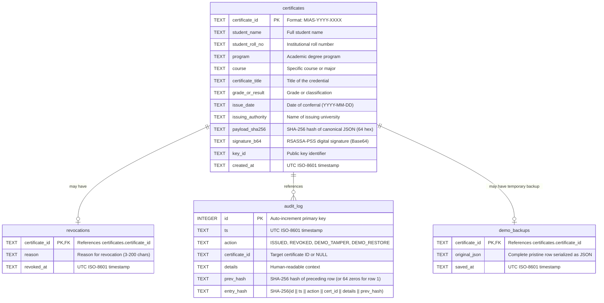
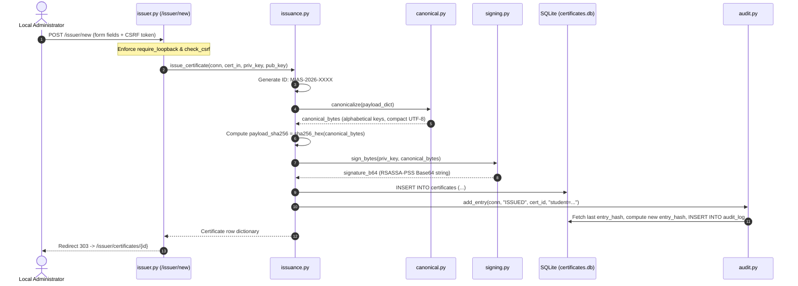
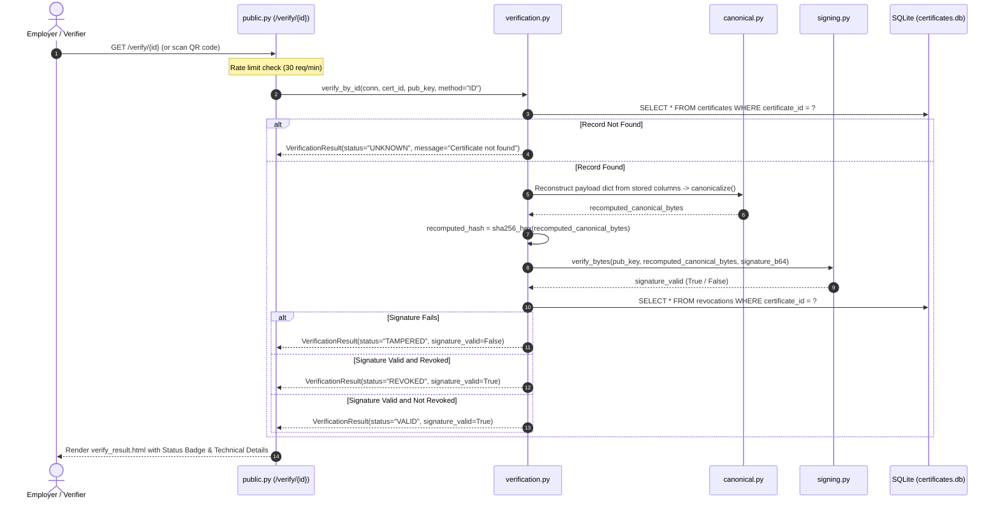

# 02: System Architecture

## Purpose
This document presents the architectural design, component model, data flow, entity relationships, and sequence interactions of the **Meridian Certificate Registry**.

---

## 1. System Architecture & Boundaries

```mermaid
graph TB
    subgraph ClientLayer["Clients & Verification Channels"]
        Browser["Modern Web Browser<br/>(Verifiers & Students)"]
        Phone["Mobile Camera / QR Scanner"]
        LocalAdmin["Local Administrator<br/>(Loopback 127.0.0.1)"]
        OfflineCLI["Offline Verifier Script<br/>(verify_offline.py)"]
    end

    subgraph SecurityBoundary["FastAPI Application Boundary (app/main.py)"]
        SecHeaders["SecurityHeadersMiddleware<br/>(CSP, HSTS, X-Content-Type)"]
        LoopbackGuard["Loopback Check<br/>(require_loopback)"]
        CSRFGuard["CSRF Protection<br/>(check_csrf)"]
        RateLimiter["Rate Limiter<br/>(30 req/min)"]

        subgraph Routers["FastAPI Routers"]
            PubR["public.py<br/>(/, /verify, /certificates/*)"]
            IssR["issuer.py<br/>(/issuer/*)"]
            DemoR["demo.py<br/>(/demo/*)"]
            ApiR["api.py<br/>(/api/*)"]
        end

        subgraph ServiceLayer["Service Layer (app/services/)"]
            IssSvc["issuance.py<br/>(Certificate creation & canonicalization)"]
            VerSvc["verification.py<br/>(Signature, hash & revocation check)"]
            RevSvc["revocation.py<br/>(Revocation recording)"]
            AudSvc["audit.py<br/>(Hash-chained event log)"]
            PdfSvc["pdf.py<br/>(ReportLab certificate generation)"]
            QrSvc["qr.py<br/>(PNG generation & URL building)"]
            DemoSvc["demo_tools.py<br/>(Tamper & restore simulator)"]
        end

        subgraph CryptoEngine["Cryptographic Core (app/crypto/)"]
            Canonical["canonical.py<br/>(Deterministic canonical JSON)"]
            Signing["signing.py<br/>(RSASSA-PSS SHA-256 sign/verify)"]
            Keys["keys.py<br/>(Keypair generation, PEM I/O, fingerprints)"]
        end
    end

    subgraph StorageLayer["Data & Key Storage"]
        SQLite[("SQLite Database<br/>(certificates.db)")]
        KeyFiles["Key Store<br/>(keys/issuer_private.pem & issuer_public.pem)"]
    end

    %% Client connections
    Browser -->|HTTP GET /verify| SecHeaders
    Phone -->|Scan QR /verify/{id}| SecHeaders
    LocalAdmin -->|HTTP GET/POST /issuer| SecHeaders
    OfflineCLI -.->|Reads Bundle + Public Key| CryptoEngine

    SecHeaders --> PubR
    SecHeaders --> ApiR
    SecHeaders --> LoopbackGuard
    LoopbackGuard --> CSRFGuard
    CSRFGuard --> IssR
    CSRFGuard --> DemoR

    PubR --> RateLimiter
    ApiR --> RateLimiter
    RateLimiter --> VerSvc

    IssR --> IssSvc
    DemoR --> DemoSvc
    PubR --> PdfSvc
    PubR --> QrSvc

    IssSvc --> Canonical
    IssSvc --> Signing
    VerSvc --> Canonical
    VerSvc --> Signing
    IssSvc --> AudSvc
    RevSvc --> AudSvc

    Signing --> KeyFiles
    IssSvc --> SQLite
    VerSvc --> SQLite
    RevSvc --> SQLite
    AudSvc --> SQLite
    DemoSvc --> SQLite
```

---

## 2. Component Descriptions

| Component | File Path | Responsibility |
|---|---|---|
| **Security Middleware** | `app/security.py` | Enforces Content-Security-Policy, strict loopback IP validation, SameSite CSRF cookies, and IP sliding-window rate limiting. |
| **Public Router** | `app/routers/public.py` | Serves public landing page, certificate search/verify forms, verification result page, PDF downloads, QR codes, and public key PEM. |
| **Issuer Router** | `app/routers/issuer.py` | Handles administrative issuance workflow, listing with search/filter, certificate details, and revocation dialog. Restricted to loopback. |
| **Demo Router** | `app/routers/demo.py` | Provides classroom tamper lab to alter database records, recompute hashes, and verify manipulated bundles. Restricted to loopback and demo mode. |
| **API Router** | `app/routers/api.py` | Provides JSON REST endpoints for health checks, public key information, certificate creation, verification, and revocation. |
| **Canonicalizer** | `app/crypto/canonical.py` | Deterministic canonical JSON: fixed field set, keys sorted alphabetically, compact separators (',' and ':'), UTF-8 encoding, and Unicode NFC normalization with surrounding whitespace stripped. It is inspired by JSON Canonicalization Scheme (RFC 8785) but is not a full implementation of it. |
| **Signer** | `app/crypto/signing.py` | Generates and verifies RSASSA-PSS signatures with SHA-256 and 32-byte salt using the `cryptography` library. |
| **Key Manager** | `app/crypto/keys.py` | Manages 2048-bit RSA keys, PKCS#8 encrypted PEM storage, and computes public-key SHA-256 fingerprints. |
| **Verification Service** | `app/services/verification.py` | Orchestrates end-to-end verification: payload reconstruction, hash recomputation, signature validation, and revocation lookup. |
| **Audit Service** | `app/services/audit.py` | Logs events into a cryptographically chained audit log where each record commits to the previous record's SHA-256 hash. |
| **PDF Service** | `app/services/pdf.py` | Renders high-fidelity A4 landscape PDF diplomas with double borders, official typography, QR code, and public key fingerprint. |

---

## 3. Entity-Relationship Diagram (Database Schema)

Derived directly from `app/db.py`:



---

## 4. Issuance Sequence Flow



---

## 5. Verification Sequence Flow


